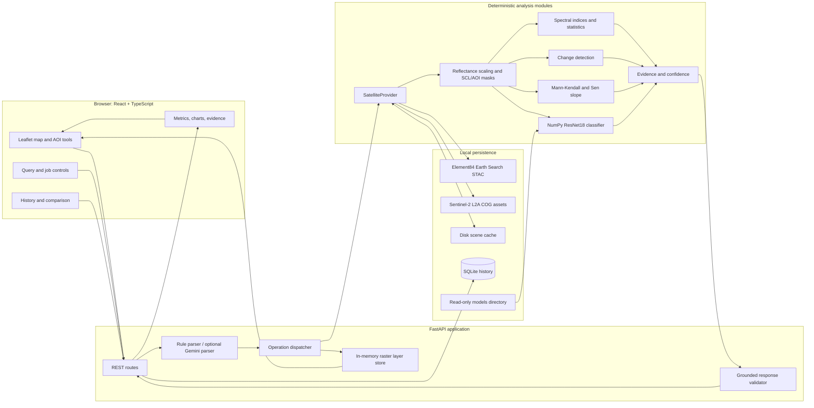
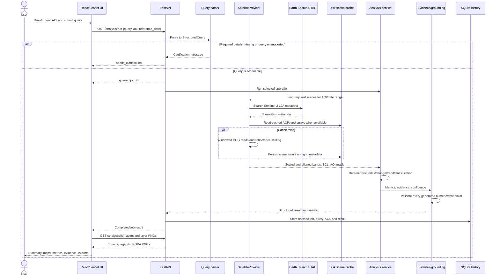
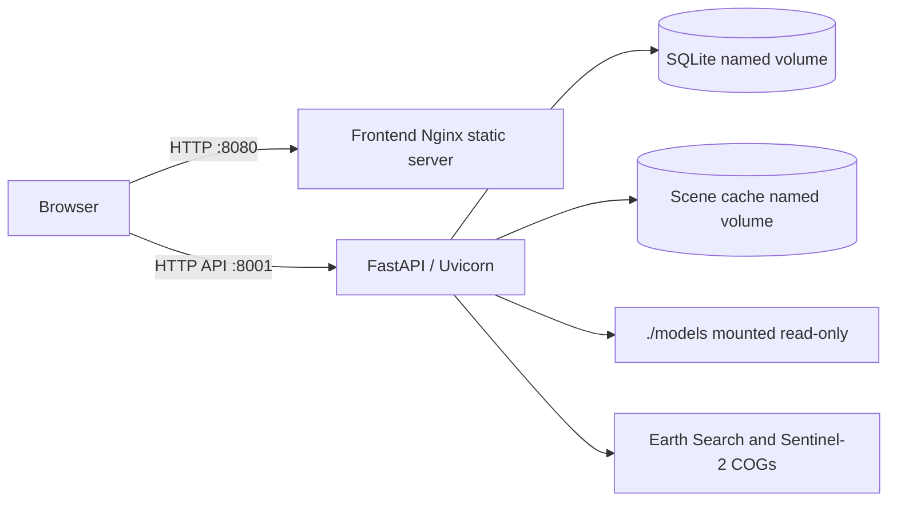

# SatQuery AI Architecture

## Scope

This document describes the implemented MVP. The browser application is React, Vite, TypeScript, and Leaflet. The API and analysis pipeline are FastAPI and Python. Sentinel-2 L2A assets are discovered through Element84 Earth Search and read from COGs over the AOI. Completed job records are stored in SQLite; downloaded scene arrays are cached on disk.

## Component diagram

## Data-flow diagram

## Runtime boundaries

- The LLM is an optional query interpreter and explanation writer. Analysis services compute metrics and confidence; LLM output is not a source of measurements.
- `SatelliteProvider` hides STAC search and COG access from analysis services. The current provider is Element84 Earth Search.
- Raster reads are limited to the AOI bounding window. Product scale/offset metadata is used before index calculation; SCL and AOI masks control valid pixels.
- `backend/.cache/satquery` is the native scene cache path. In Compose it is mounted to the `satellite-cache` volume.
- Completed history records use SQLite at `SATQUERY_DB`; Compose mounts the `satquery-db` volume at `/app/.data`.
- Rendered arrays are retained in process memory for up to 20 jobs. They are not part of the SQLite record and disappear when the API process restarts.
- Land-cover weights and metadata are loaded from `SATQUERY_MODEL_DIR`; Compose mounts the repository `models/` directory read-only.

## Deployment topology

The browser calls the API directly; `VITE_API_URL` is compiled into the frontend bundle. `SATQUERY_CORS_ORIGINS` must include the browser origin. Docker Compose defaults to `http://localhost:8080` for the frontend and `http://localhost:8001` for the API.
