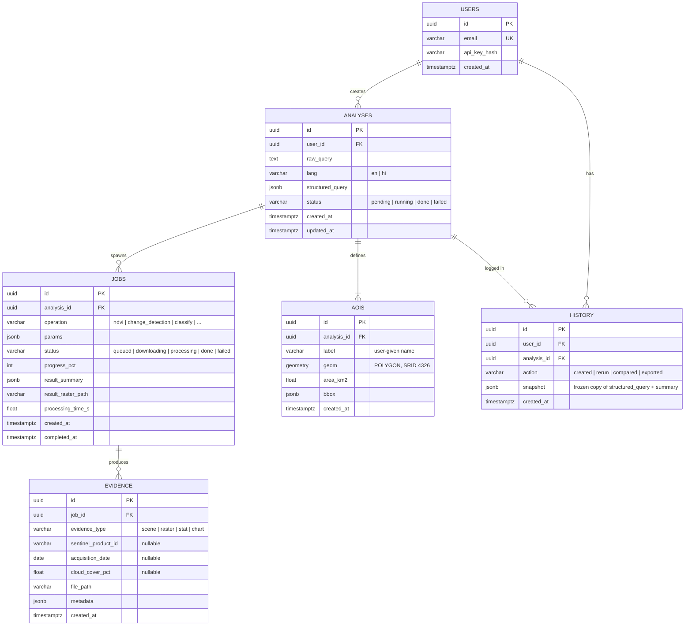

# SatQuery AI — Database Schema

## 1. Overview

The data layer uses **PostgreSQL 15** with the **PostGIS 3.4** extension for spatial operations. All geometry columns use SRID 4326 (WGS 84). UUIDs are the primary key type throughout to simplify distributed ID generation.

---

## 2. ER Diagram

---

## 3. Table Definitions

### 3.1 `users`

Minimal user record for API-key auth (MVP). Extended with OAuth fields later.

| Column | Type | Constraints | Notes |
|---|---|---|---|
| `id` | `uuid` | PK, default `gen_random_uuid()` | |
| `email` | `varchar(255)` | UNIQUE, NOT NULL | |
| `api_key_hash` | `varchar(128)` | NOT NULL | bcrypt hash of issued API key |
| `created_at` | `timestamptz` | NOT NULL, default `now()` | |

### 3.2 `analyses`

One row per user query submission. Holds both the raw text and the parsed structured query.

| Column | Type | Constraints | Notes |
|---|---|---|---|
| `id` | `uuid` | PK | |
| `user_id` | `uuid` | FK → `users.id` | |
| `raw_query` | `text` | NOT NULL | Original user input |
| `lang` | `varchar(5)` | NOT NULL, default `'en'` | ISO 639-1 |
| `structured_query` | `jsonb` | nullable | Populated after successful parse |
| `status` | `varchar(20)` | NOT NULL, default `'pending'` | One of: `pending`, `need_info`, `running`, `done`, `failed` |
| `created_at` | `timestamptz` | NOT NULL | |
| `updated_at` | `timestamptz` | NOT NULL | |

**Indexes**: `idx_analyses_user_id`, `idx_analyses_status`, `idx_analyses_created_at`

### 3.3 `jobs`

Each analysis may spawn one or more jobs (e.g., NDVI + change detection). Jobs are the unit of async execution.

| Column | Type | Constraints | Notes |
|---|---|---|---|
| `id` | `uuid` | PK | |
| `analysis_id` | `uuid` | FK → `analyses.id`, ON DELETE CASCADE | |
| `operation` | `varchar(50)` | NOT NULL | Registry key: `ndvi`, `change_detection`, `classify`, `time_series_stats`, `custom_index` |
| `params` | `jsonb` | NOT NULL | Operation-specific parameters (bands, thresholds, dates) |
| `status` | `varchar(20)` | NOT NULL, default `'queued'` | `queued` → `downloading` → `processing` → `done` / `failed` |
| `progress_pct` | `int` | default `0` | 0–100, pushed via WebSocket |
| `result_summary` | `jsonb` | nullable | Aggregate stats (mean NDVI, area changed, class distribution) |
| `result_raster_path` | `varchar(512)` | nullable | Path to output COG |
| `processing_time_s` | `float` | nullable | Wall-clock seconds |
| `error_message` | `text` | nullable | Human-readable failure reason |
| `created_at` | `timestamptz` | NOT NULL | |
| `completed_at` | `timestamptz` | nullable | |

**Indexes**: `idx_jobs_analysis_id`, `idx_jobs_status`

### 3.4 `aois`

Stores the geometry for each area of interest. An analysis has at least one AOI; comparison queries may have two.

| Column | Type | Constraints | Notes |
|---|---|---|---|
| `id` | `uuid` | PK | |
| `analysis_id` | `uuid` | FK → `analyses.id`, ON DELETE CASCADE | |
| `label` | `varchar(255)` | nullable | User-supplied or geocoded name |
| `geom` | `geometry(Polygon, 4326)` | NOT NULL | PostGIS polygon |
| `area_km2` | `float` | NOT NULL | Computed on insert via trigger |
| `bbox` | `jsonb` | NOT NULL | `[minLon, minLat, maxLon, maxLat]` |
| `created_at` | `timestamptz` | NOT NULL | |

**Indexes**: `idx_aois_analysis_id`, `idx_aois_geom USING GIST`

### 3.5 `evidence`

Every artefact produced by a job—downloaded scenes, output rasters, computed statistics, chart data—is an evidence record. This provides full traceability from result back to source scene.

| Column | Type | Constraints | Notes |
|---|---|---|---|
| `id` | `uuid` | PK | |
| `job_id` | `uuid` | FK → `jobs.id`, ON DELETE CASCADE | |
| `evidence_type` | `varchar(20)` | NOT NULL | `scene`, `raster`, `stat`, `chart` |
| `sentinel_product_id` | `varchar(100)` | nullable | Copernicus product UUID for source scenes |
| `acquisition_date` | `date` | nullable | Scene capture date |
| `cloud_cover_pct` | `float` | nullable | Scene-level cloud % |
| `file_path` | `varchar(512)` | NOT NULL | Relative path in tile store |
| `metadata` | `jsonb` | nullable | Band info, resolution, CRS, or chart config |
| `created_at` | `timestamptz` | NOT NULL | |

**Indexes**: `idx_evidence_job_id`, `idx_evidence_type`

### 3.6 `history`

Audit log of user actions for the history sidebar and re-run capability.

| Column | Type | Constraints | Notes |
|---|---|---|---|
| `id` | `uuid` | PK | |
| `user_id` | `uuid` | FK → `users.id` | |
| `analysis_id` | `uuid` | FK → `analyses.id` | |
| `action` | `varchar(20)` | NOT NULL | `created`, `rerun`, `compared`, `exported` |
| `snapshot` | `jsonb` | NOT NULL | Frozen copy of `structured_query` + result summary at that point |
| `created_at` | `timestamptz` | NOT NULL | |

**Indexes**: `idx_history_user_id`, `idx_history_created_at`

---

## 4. Migrations Strategy

- Use **Alembic** for schema migrations
- Every migration is forward-only in MVP; add down-migrations before production
- Seed script creates a test user with a known API key for local development

---

## 5. Data Retention

| Data | Retention |
|---|---|
| Sentinel-2 scene cache | LRU eviction when disk > configured limit (default 50 GB) |
| Result rasters (COGs) | Kept indefinitely; user can delete via API |
| Database records | Kept indefinitely; soft-delete pattern for analyses |
| History snapshots | Immutable audit log, never deleted |
