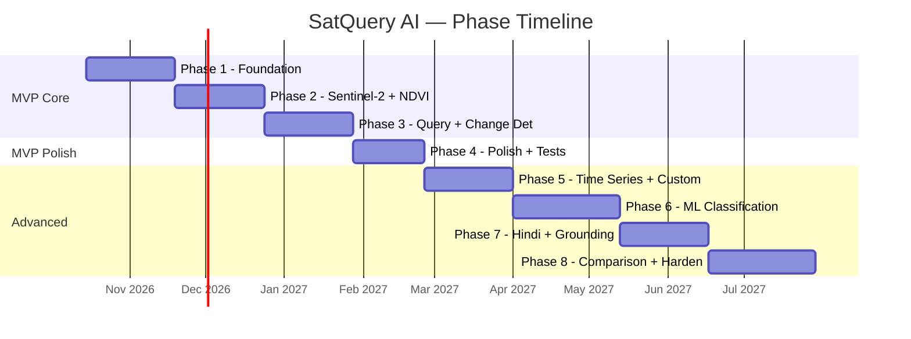

# SatQuery AI — Project Plan

## Timeline: ~1 Year (8 Phases)

**First milestone (demoable ~30%):** End of Phase 3 — map + AOI + real Sentinel-2 retrieval + NDVI + before/after change detection + basic query parsing.

---

## Phase Overview

> Phases are roughly 4–6 weeks each. Buffer weeks are built into later phases. Total: ~41 weeks ≈ 10 months, leaving ~2 months of buffer in the 1-year window.

---

## Phase 1 — Foundation `[MVP]`

**Duration:** ~5 weeks

### Scope

Set up the project skeleton, database, API scaffold, and frontend shell with a working map + AOI drawing.

### Deliverables

| # | Deliverable | Category |
|---|---|---|
| 1.1 | Project repo with monorepo structure (`backend/`, `frontend/`, `docs/`, `tests/`) | MVP |
| 1.2 | Docker Compose: FastAPI + PostgreSQL/PostGIS + React dev server | MVP |
| 1.3 | Database schema (Alembic migrations for `users`, `analyses`, `jobs`, `aois`, `evidence`, `history`) | MVP |
| 1.4 | FastAPI scaffold: health check, API-key auth middleware, error handlers | MVP |
| 1.5 | React app shell: Leaflet map, AOI polygon drawing tool, basic layout | MVP |
| 1.6 | `POST /api/v1/aois` + `GET /api/v1/aois` — create and list AOIs | MVP |
| 1.7 | CI pipeline: lint + unit tests on push | MVP |
| 1.8 | Config system (`config.yaml` + env-var overrides) | MVP |

### Done When

- [ ] `docker-compose up` launches all services without errors
- [ ] Can draw a polygon on the map and save it via API; polygon persists in DB and reloads on refresh
- [ ] Unit tests pass in CI
- [ ] API docs auto-generated at `/docs` (Swagger UI)

### Risks

| Risk | Mitigation |
|---|---|
| PostGIS setup complexity on Windows | Use Docker-only development; document WSL2 setup |
| Leaflet AOI drawing UX edge cases | Use `react-leaflet-draw`; limit to Polygon type in MVP |

---

## Phase 2 — Sentinel-2 Retrieval + NDVI `[MVP]`

**Duration:** ~5 weeks

### Scope

Build the Sentinel-2 client (search + download), scene cache, tile slicer, NDVI operation, and tile-serving endpoint. End-to-end: given an AOI + date range, produce an NDVI raster on the map.

### Deliverables

| # | Deliverable | Category |
|---|---|---|
| 2.1 | Sentinel-2 catalogue client (Copernicus ODATA search) | MVP |
| 2.2 | Scene download with retry + exponential backoff | MVP |
| 2.3 | Content-addressed scene cache (keyed by product ID) | MVP |
| 2.4 | Tile slicer: AOI → 256×256 tile grid | MVP |
| 2.5 | Operation registry scaffold + NDVI operation | MVP |
| 2.6 | Job lifecycle: create → downloading → processing → done/failed | MVP |
| 2.7 | `POST /api/v1/query` (hardcoded parser, no LLM yet) — accepts `{ aoi_id, operation: "ndvi", date_range }` | MVP |
| 2.8 | Tile server: `GET /api/v1/tiles/{job_id}/{z}/{x}/{y}.png` with configurable colormap | MVP |
| 2.9 | Frontend: simple form to trigger NDVI analysis; display result layer on map | MVP |
| 2.10 | WebSocket progress updates during job execution | MVP |

### Done When

- [ ] Can select a saved AOI, pick a date range, run NDVI, and see a coloured overlay on the map
- [ ] Real Sentinel-2 scenes are downloaded from Copernicus (not fixture data)
- [ ] Cached scenes are reused on repeat requests
- [ ] Job progress is streamed to the frontend in real time
- [ ] NDVI stats (mean, min, max) shown in a results panel

### Risks

| Risk | Mitigation |
|---|---|
| Copernicus API rate limits or auth changes | Register early; implement retry; cache aggressively; have a fixture fallback for dev |
| Large scene download times (> 1 GB) | Download only the bands needed (B04, B08), not full product; stream to disk |
| GeoTIFF handling complexity | Use `rasterio` + `rioxarray`; invest time in understanding CRS reprojection early |

---

## Phase 3 — Query Parsing + Change Detection `[MVP]`

**Duration:** ~5 weeks

### Scope

Replace the hardcoded parser with LLM-powered natural-language parsing (Gemini structured output). Add the change detection operation. This completes the first demoable milestone.

### Deliverables

| # | Deliverable | Category |
|---|---|---|
| 3.1 | LLM query parser: Gemini API with structured output → `StructuredQuery` Pydantic model | MVP |
| 3.2 | Ask-back protocol: 422 response with `missing_fields` + `questions` | MVP |
| 3.3 | Conversation follow-up endpoint: `POST /api/v1/query/{conversation_id}/follow-up` | MVP |
| 3.4 | Change detection operation (before/after NDVI diff) | MVP |
| 3.5 | Frontend: natural-language query input replacing the form | MVP |
| 3.6 | Frontend: ask-back chat flow (display questions, accept answers) | MVP |
| 3.7 | Frontend: change detection result display (diverging colormap + stats) | MVP |
| 3.8 | Query understanding test set: initial 40 test cases (English only) | MVP |
| 3.9 | Integration tests: query → job → result pipeline with mocked LLM + scene fixtures | MVP |

### Done When

- [ ] User types "Show NDVI change in [place] from Jan to Jun 2024" → system produces a change map
- [ ] If user omits location, system asks back in a chat-like interface
- [ ] Query eval scores: operation accuracy ≥ 85%, field extraction F1 ≥ 0.80 (on initial 40 cases)
- [ ] Change detection stats (area increased/decreased, mean change) shown in results panel
- [ ] **Demo-ready**: a non-technical person can type a question, draw an AOI, and get a meaningful result

### Risks

| Risk | Mitigation |
|---|---|
| LLM structured output unreliability | Use Gemini's native JSON mode; add Pydantic validation as safety net; fallback to re-prompt on parse failure (up to 2 retries) |
| Ask-back UX complexity | Keep it simple: max 3 rounds, then show the partial query for manual editing |
| Geocoding accuracy for Indian place names | Use Nominatim + fallback to Google Geocoding API; let user correct on map |

---

## Phase 4 — MVP Polish + Testing `[MVP]`

**Duration:** ~4 weeks

### Scope

Harden the MVP. Fix bugs, improve UX, expand test coverage, add history sidebar, and prepare for demo/review.

### Deliverables

| # | Deliverable | Category |
|---|---|---|
| 4.1 | History sidebar: `GET /api/v1/history`, click to reload past analysis | MVP |
| 4.2 | Analysis detail page: full metadata, evidence list, re-run button | MVP |
| 4.3 | Error handling polish: user-friendly error messages for all failure modes | MVP |
| 4.4 | Loading states, progress bar, skeleton screens | MVP |
| 4.5 | Expand query eval to 60 test cases; tune system prompt | MVP |
| 4.6 | Pipeline timing benchmarks (baseline numbers) | MVP |
| 4.7 | API rate limiting middleware | MVP |
| 4.8 | README, setup guide, demo script | MVP |
| 4.9 | Bug-fix sprint based on internal testing | MVP |

### Done When

- [ ] No P0 bugs in the full query → result flow
- [ ] History sidebar works; past analyses reload correctly
- [ ] Query eval: operation accuracy ≥ 88%, field F1 ≥ 0.83
- [ ] All pipeline stages meet timing targets (see TESTING.md §5)
- [ ] A new developer can set up the project in < 30 minutes following the README

### Risks

| Risk | Mitigation |
|---|---|
| Scope creep from "one more fix" | Timebox the bug-fix sprint to 1.5 weeks; track with a fixed issue list |
| Performance regressions | Benchmark baselines established early; CI checks for > 20% regression |

---

## Phase 5 — Time-Series Statistics + Custom Indices `[Advanced]`

**Duration:** ~5 weeks

### Scope

Add the time-series stats operation and the custom band index operation. These are the first "advanced" features — they use the same pipeline but unlock new analytical capabilities.

### Deliverables

| # | Deliverable | Category |
|---|---|---|
| 5.1 | Time-series stats operation: multi-scene index calculation + trend line | Advanced |
| 5.2 | Frontend: time-series chart (Chart.js line chart with date axis) | Advanced |
| 5.3 | Custom index operation: user-defined band math formulas | Advanced |
| 5.4 | Preset index library: NDWI, EVI, SAVI, NBR | Advanced |
| 5.5 | Frontend: index formula input or preset selector | Advanced |
| 5.6 | Multi-scene download optimisation (parallel downloads, band-specific) | Advanced |
| 5.7 | Expand query eval: +15 cases for new operations, total 75 | Advanced |

### Done When

- [ ] User can request "NDVI trend for [place] over the last year" → line chart with trend
- [ ] User can compute NDWI to detect water bodies
- [ ] Time-series with ≥ 6 data points renders a usable chart
- [ ] Custom formula validation prevents unsafe expressions

### Risks

| Risk | Mitigation |
|---|---|
| Insufficient cloud-free scenes for time series | Allow user to relax cloud cover threshold; show cloud % per data point; interpolate gaps |
| Band math injection / safety | Parse formula into AST; whitelist only arithmetic ops + band references |

---

## Phase 6 — ML Land-Use Classification `[Advanced]`

**Duration:** ~6 weeks

### Scope

Integrate the EuroSAT-trained ResNet18 for land-use classification. Build the inference pipeline, evaluate on Indian data, and create the confidence-aware UI.

### Deliverables

| # | Deliverable | Category |
|---|---|---|
| 6.1 | ResNet18 model integration: load weights, batch inference | Advanced |
| 6.2 | Classify operation: patch extraction → inference → reassemble | Advanced |
| 6.3 | 10-class → 5-class mapping with confidence scores | Advanced |
| 6.4 | Frontend: classification map layer with legend and confidence heatmap | Advanced |
| 6.5 | Frontend: class distribution bar chart | Advanced |
| 6.6 | EuroSAT test-set evaluation: verify ≥ 92% accuracy | Advanced |
| 6.7 | Indian validation set: collect + label 500 patches across 5 regions | Advanced |
| 6.8 | Indian evaluation: measure accuracy, document per-class performance | Advanced |
| 6.9 | Limitations display: confidence warning in UI, accuracy disclaimers | Advanced |
| 6.10 | Cloud/shadow masking using SCL band | Advanced |

### Done When

- [ ] User can request land-use classification for an AOI → coloured map + stats
- [ ] EuroSAT test accuracy ≥ 92% (10-class), ≥ 95% (5-class)
- [ ] Indian validation accuracy documented honestly (even if < target)
- [ ] Low-confidence patches visually distinct on the map
- [ ] Limitations statement shown in every classification result

### Risks

| Risk | Mitigation |
|---|---|
| Domain shift: poor accuracy on Indian terrain | Document honestly; plan fine-tuning if accuracy < 70%; show confidence prominently |
| Labelling effort for Indian val set | Use Google Earth high-res as reference; aim for 500 patches (manageable in 2 weeks) |
| CPU inference too slow for large AOIs | Batch size tuning; consider ONNX Runtime for 2–3× speedup; document timing |

---

## Phase 7 — Hindi Support + Grounding Validator `[Advanced]`

**Duration:** ~5 weeks

### Scope

Add full Hindi query support and the grounding validator that checks parsed queries against physical/data constraints.

### Deliverables

| # | Deliverable | Category |
|---|---|---|
| 7.1 | Hindi system prompt tuning + Hindi term mapping table | Advanced |
| 7.2 | Hindi ask-back: questions generated in Hindi when `lang=hi` | Advanced |
| 7.3 | Frontend: language toggle (EN/HI), auto-detect from input | Advanced |
| 7.4 | Hindi query eval: 15 test cases, parity check vs English | Advanced |
| 7.5 | Grounding validator: date range, AOI size, band availability, cloud cover checks | Advanced |
| 7.6 | Grounding error messages: specific, actionable ("No Sentinel-2 data before 2015") | Advanced |
| 7.7 | Full query eval suite: 85 cases, meet all targets | Advanced |

### Done When

- [ ] Hindi query produces identical results to equivalent English query
- [ ] Hindi accuracy within 5% of English on eval suite
- [ ] Grounding validator catches: future dates, pre-2015 dates, > 100 km² AOI, invalid bands
- [ ] Validation errors shown as helpful messages, not raw errors

### Risks

| Risk | Mitigation |
|---|---|
| Hindi NLP quality varies by LLM | Test with multiple queries; maintain the Hindi term mapping table as a supplement to the LLM |
| Grounding validator too strict/lenient | Start with hard constraints only (dates, size); soft warnings for cloud cover |

---

## Phase 8 — Comparison Workspace + Hardening `[Advanced]`

**Duration:** ~6 weeks

### Scope

Build the comparison workspace (side-by-side / swipe), export functionality, final hardening, and production readiness.

### Deliverables

| # | Deliverable | Category |
|---|---|---|
| 8.1 | Comparison workspace: side-by-side and swipe modes for two result layers | Advanced |
| 8.2 | `POST /api/v1/compare` endpoint with diff stats | Advanced |
| 8.3 | Export: GeoTIFF, PNG, PDF report, CSV stats | Advanced |
| 8.4 | E2E test suite (Playwright): 10 core user journeys | Advanced |
| 8.5 | Performance optimisation pass: identify and fix bottlenecks | Advanced |
| 8.6 | Security audit: input validation, API key rotation, CORS config | Advanced |
| 8.7 | Observability: structured logging, Prometheus metrics, health checks | Advanced |
| 8.8 | Production Docker Compose with Nginx, TLS, backup strategy | Advanced |
| 8.9 | Final documentation pass: user guide, API reference, deployment guide | Advanced |
| 8.10 | Model improvement plan execution (fine-tune if Indian accuracy < 75%) | Advanced |

### Done When

- [ ] User can swipe-compare two time periods on the map
- [ ] Export produces a clean PDF report with map, stats, and metadata
- [ ] E2E tests pass on the Docker Compose stack
- [ ] No P0/P1 bugs; all P2 bugs documented
- [ ] Deployment guide tested by a fresh setup on a clean machine
- [ ] Project retrospective document written

### Risks

| Risk | Mitigation |
|---|---|
| Comparison UI complexity (sync two map viewports) | Use Leaflet.Sync plugin; start with swipe-only, add side-by-side if time permits |
| PDF report generation | Use `reportlab` or `weasyprint`; template-based to avoid complexity |
| Time pressure from accumulated scope | Phase 8 has explicit cut list: items 8.7–8.10 can be deferred if behind schedule |

---

## Summary: MVP vs Advanced Features

| Feature | Phase | Category |
|---|---|---|
| Map + AOI drawing | 1 | **MVP** |
| Database + API scaffold | 1 | **MVP** |
| Sentinel-2 search + download + cache | 2 | **MVP** |
| NDVI operation + tile server | 2 | **MVP** |
| WebSocket progress | 2 | **MVP** |
| LLM query parser (English) | 3 | **MVP** |
| Ask-back protocol | 3 | **MVP** |
| Change detection | 3 | **MVP** |
| History sidebar | 4 | **MVP** |
| Test coverage + benchmarks | 4 | **MVP** |
| Time-series statistics | 5 | **Advanced** |
| Custom band indices (NDWI, EVI, etc.) | 5 | **Advanced** |
| ML land-use classification | 6 | **Advanced** |
| Hindi query support | 7 | **Advanced** |
| Grounding validator | 7 | **Advanced** |
| Comparison workspace (swipe/side-by-side) | 8 | **Advanced** |
| Export (GeoTIFF, PDF, CSV) | 8 | **Advanced** |
| Production hardening | 8 | **Advanced** |

---

## Top 5 Technical Risks

### 1. Copernicus API Reliability and Rate Limits

**Severity:** High — the entire pipeline depends on scene downloads.

**What could go wrong:** API downtime, auth token expiry, throttling during peak usage, or breaking API changes.

**Mitigation:**
- Aggressive local caching — once a scene is downloaded, it's never re-downloaded
- Retry with exponential backoff (3 attempts, 2s/4s/8s delays)
- Fallback to pre-downloaded fixture scenes for development and testing
- Abstract the client behind an interface so we can swap to AWS Earth Search or Google Earth Engine if Copernicus becomes unreliable
- Monitor Copernicus status page; set up alerts

### 2. LLM Query Parsing Reliability

**Severity:** High — the core UX depends on the LLM understanding user intent correctly.

**What could go wrong:** The LLM misinterprets the query, hallucinates field values, or fails to ask back when it should. Gemini API outages. Model version changes break behaviour.

**Mitigation:**
- Pydantic validation as a hard safety net — structurally invalid output is caught
- Confidence scoring — low-confidence results get a confirmation prompt
- Curated test set (85 cases) run on every prompt/model change
- Pin the Gemini model version; test before upgrading
- Ask-back protocol limits damage — if the LLM is unsure, it asks rather than guesses
- Fallback: if LLM API is down, show a structured form as degraded UX

### 3. ML Domain Shift on Indian Terrain

**Severity:** Medium — classification is an advanced feature, but if accuracy is embarrassingly low, it undermines trust in the whole platform.

**What could go wrong:** The EuroSAT-trained model misclassifies Indian landscapes systematically (e.g., all arid land as "Pasture", dense informal settlements missed entirely).

**Mitigation:**
- Honest limitations displayed in every classification result
- Confidence heatmap makes uncertainty visible, not hidden
- Quantitative evaluation on 500 Indian patches before calling the feature "ready"
- If accuracy < 70% on Indian data: fine-tune on labelled Indian patches (Phase 8 contingency)
- Collapse to 5 classes to improve effective accuracy
- Never claim "ground truth" — always say "estimated"

### 4. Large AOI Processing Performance

**Severity:** Medium — a 100 km² AOI at 10m resolution is 100 million pixels. Naive processing will OOM or take too long.

**What could go wrong:** Memory exhaustion, > 5 minute processing times, browser timeout waiting for results.

**Mitigation:**
- Tile-based processing: 256×256 tiles processed independently (< 1 MB each)
- Streaming results via WebSocket — user sees progress, not a spinner
- Configurable AOI size limit (default 100 km²)
- Worker pool with configurable parallelism
- Band-specific downloads (don't download all 13 bands when only 2 are needed)
- COG (Cloud-Optimised GeoTIFF) output for efficient tile serving

### 5. GeoTIFF / CRS Complexity

**Severity:** Medium — coordinate reference system mismatches, reprojection errors, and raster alignment bugs are subtle and hard to debug.

**What could go wrong:** NDVI computed on misaligned bands, tiles not lining up on the map, AOI clipping errors, incorrect area calculations.

**Mitigation:**
- Standardise on EPSG:4326 for all storage and display; reproject on ingest
- Use `rasterio` and `rioxarray` consistently (not mixing libraries)
- Comprehensive unit tests with known-geometry fixtures
- Visual regression tests: render known AOI → compare against reference image
- Invest upfront time (Phase 2) in understanding the Sentinel-2 tiling grid and band resolutions

---

## Open Questions (max 5)

1. **Copernicus account**: Do you already have a Copernicus Data Space Ecosystem account with ODATA API access, or should I plan time for registration and quota approval in Phase 2?

2. **LLM choice**: I've designed around Google Gemini for structured output. Are you committed to Gemini, or open to alternatives (OpenAI, local models via Ollama)? This affects the prompt engineering approach and cost.

3. **Deployment target**: Is this going to run on your local machine only, on a VPS/cloud VM, or do you need it deployable to a specific cloud provider? This affects the Docker Compose setup and whether we need persistent storage volumes.

4. **User model**: Is this single-user (your own tool) or multi-user? The current design supports multiple users with API keys, but if it's single-user we can simplify auth and skip rate limiting.

5. **Indian validation data**: For the ML evaluation (Phase 6), I've planned to manually label 500 patches using Google Earth as reference. Are you willing to help with labelling, or should I budget more time for this and plan a semi-automated labelling workflow?
