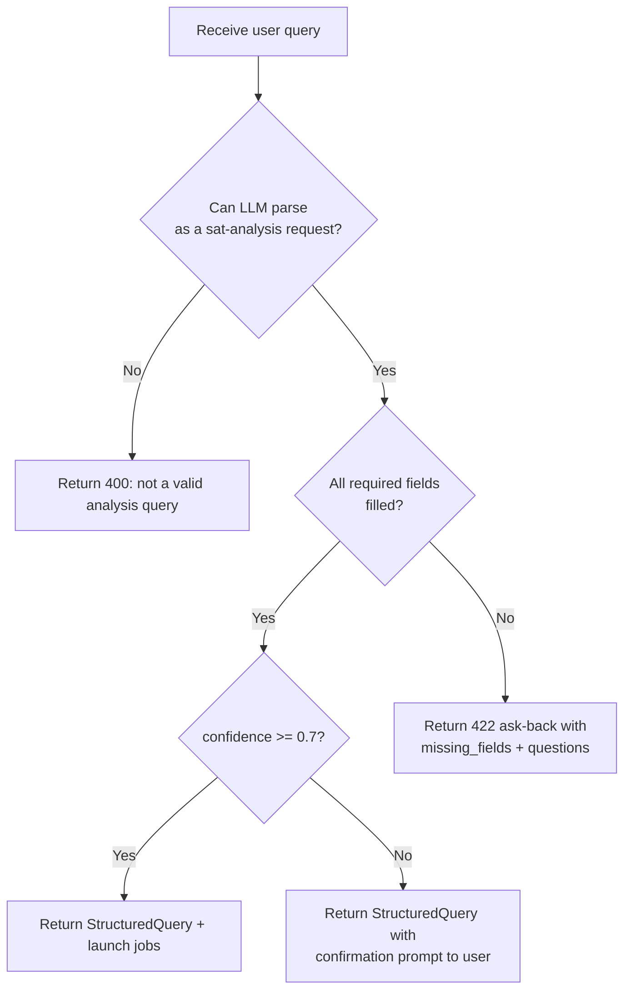

# SatQuery AI — Structured Query Schema

## 1. Purpose

The query parser takes free-form text (English or Hindi) and produces a `StructuredQuery` — a Pydantic model that the orchestrator can execute deterministically. This document defines that schema, the ask-back protocol for incomplete queries, and how multilingual input maps to the same canonical schema.

---

## 2. The `StructuredQuery` Pydantic Model

```python
from __future__ import annotations
from datetime import date
from enum import Enum
from typing import Optional
from pydantic import BaseModel, Field, model_validator


class OperationType(str, Enum):
    NDVI = "ndvi"
    CHANGE_DETECTION = "change_detection"
    CLASSIFY = "classify"
    TIME_SERIES_STATS = "time_series_stats"
    CUSTOM_INDEX = "custom_index"


class DateRange(BaseModel):
    start: date
    end: date

    @model_validator(mode="after")
    def end_after_start(self):
        if self.end < self.start:
            raise ValueError("end must be >= start")
        return self


class AOISpec(BaseModel):
    """One of geojson, bbox, or place_name must be provided."""
    geojson: Optional[dict] = None          # GeoJSON Polygon
    bbox: Optional[list[float]] = None      # [minLon, minLat, maxLon, maxLat]
    place_name: Optional[str] = None        # "Yamuna floodplain" → geocoded later
    aoi_id: Optional[str] = None            # Reference to a saved AOI

    @model_validator(mode="after")
    def at_least_one(self):
        if not any([self.geojson, self.bbox, self.place_name, self.aoi_id]):
            raise ValueError("At least one AOI specifier required")
        return self


class OperationParams(BaseModel):
    """Operation-specific parameters extracted from the query."""
    bands: Optional[list[str]] = None                # e.g. ["B04", "B08"]
    index_formula: Optional[str] = None              # e.g. "(B08 - B04) / (B08 + B04)"
    cloud_cover_max: Optional[int] = Field(default=20, ge=0, le=100)
    threshold: Optional[float] = None                # For change detection significance
    classification_model: Optional[str] = "eurosat"  # Model registry key
    time_step: Optional[str] = None                  # "monthly", "weekly" for time series


class ComparisonSpec(BaseModel):
    """For before/after or two-area comparisons."""
    mode: str = "temporal"                            # "temporal" | "spatial"
    date_range_a: Optional[DateRange] = None
    date_range_b: Optional[DateRange] = None
    aoi_a: Optional[AOISpec] = None
    aoi_b: Optional[AOISpec] = None


class StructuredQuery(BaseModel):
    """
    The canonical, language-agnostic representation of a user's
    satellite analysis request.
    """
    operations: list[OperationType]
    aoi: AOISpec
    date_range: DateRange
    comparison: Optional[ComparisonSpec] = None
    params: OperationParams = OperationParams()
    confidence: float = Field(
        ge=0.0, le=1.0,
        description="Parser's confidence that it understood the query correctly"
    )
```

---

## 3. Field Requirements and Ask-Back Logic

### 3.1 Field Classification

| Field | Required? | If missing … |
|---|---|---|
| `operations` | **Yes** | Ask-back: "What analysis would you like? For example: vegetation health (NDVI), land-use classification, or change detection." |
| `aoi` | **Yes** | Ask-back: "Which area should I analyse? Draw a polygon on the map, or name a place." |
| `date_range.start` | **Yes** | Ask-back: "From which date should the analysis start?" |
| `date_range.end` | **Yes** | Defaults to today if query says "current" / "latest"; otherwise ask-back. |
| `params.cloud_cover_max` | No | Defaults to `20` |
| `params.bands` | No | Inferred from operation (e.g., NDVI → B04, B08) |
| `params.threshold` | No | Defaults per operation (change detection → 0.1) |
| `comparison` | No | Only populated if the query is comparative ("before vs after", "compare X with Y") |
| `confidence` | Auto | Set by the parser; never asked from user |

### 3.2 Ask-Back vs Error



**Rules:**

1. **Ask-back (422)**: The parser understood *intent* but needs more detail. Response includes `missing_fields`, human-readable `questions` (in the user's language), and a `partial_query` with fields filled so far.
2. **Error (400)**: The input is not recognisable as a satellite analysis request at all (e.g., "What's the weather today?").
3. **Low-confidence confirmation**: If confidence is between 0.5 and 0.7, return the parsed query with a confirmation prompt: "I understood this as [summary]. Is that correct?"
4. **Below 0.5 confidence**: Treat as a 400.

### 3.3 Conversation State

Ask-back interactions form a short conversation:

1. `POST /api/v1/query` → 422 with `conversation_id`
2. `POST /api/v1/query/{conversation_id}/follow-up` with the user's answer
3. The parser receives the *accumulated* context (original query + follow-ups) and re-attempts parsing

Maximum conversation depth: **3 rounds**. After that, return the partial query for manual correction on the frontend.

---

## 4. Multilingual Mapping (English + Hindi)

### 4.1 Design Decision

The `StructuredQuery` schema is **language-agnostic**. All field values are in English. The LLM is responsible for translating Hindi input into English field values.

### 4.2 How It Works

```
User (Hindi): "यमुना के मैदान में जनवरी से जून 2024 तक NDVI बदलाव दिखाओ"
                              ↓
           LLM (system prompt + structured output)
                              ↓
StructuredQuery:
  operations: ["ndvi", "change_detection"]
  aoi: { place_name: "Yamuna floodplain" }
  date_range: { start: "2024-01-01", end: "2024-06-30" }
```

### 4.3 System Prompt Strategy

The LLM system prompt contains:

1. The Pydantic schema as a JSON Schema (auto-generated via `model_json_schema()`)
2. Explicit instruction: *"The user may write in English or Hindi. Always output field values in English. Translate place names to their standard English transliteration."*
3. A mapping table for common Hindi terms:

| Hindi term | English mapping |
|---|---|
| वनस्पति स्वास्थ्य / हरियाली | `ndvi` |
| बदलाव / परिवर्तन | `change_detection` |
| भूमि उपयोग / ज़मीन का प्रकार | `classify` |
| समय श्रृंखला | `time_series_stats` |
| तुलना / मुकाबला | `comparison` |
| बादल | `cloud_cover_max` |

4. Ask-back questions are generated in the **user's detected language** (`lang` field on the analysis).

### 4.4 Language Detection

- Primary: Explicit `lang` field in the request (if the frontend detects it)
- Fallback: The LLM infers language from the input text and sets `lang` in its response

---

## 5. Schema Evolution

| Version | Changes |
|---|---|
| `v1` (MVP) | `operations`, `aoi`, `date_range`, `params` (NDVI + change detection only) |
| `v2` | Add `comparison`, `classification_model`, `time_step` |
| `v3` | Add `custom_index`, grounding validator fields |

The API version and schema version advance together. Old schemas are supported for one major version via adapter functions.

---

## 6. Examples

### 6.1 Simple NDVI query

**Input:** "Calculate NDVI for this area in March 2024"  
*(AOI drawn on map)*

```json
{
  "operations": ["ndvi"],
  "aoi": { "geojson": { "type": "Polygon", "coordinates": "..." } },
  "date_range": { "start": "2024-03-01", "end": "2024-03-31" },
  "params": { "bands": ["B04", "B08"], "cloud_cover_max": 20 },
  "confidence": 0.95
}
```

### 6.2 Before/After change detection

**Input:** "Compare vegetation before and after the 2024 monsoon in district Varanasi"

```json
{
  "operations": ["ndvi", "change_detection"],
  "aoi": { "place_name": "Varanasi district" },
  "date_range": { "start": "2024-05-01", "end": "2024-10-31" },
  "comparison": {
    "mode": "temporal",
    "date_range_a": { "start": "2024-05-01", "end": "2024-06-15" },
    "date_range_b": { "start": "2024-09-15", "end": "2024-10-31" }
  },
  "params": { "threshold": 0.15 },
  "confidence": 0.88
}
```

### 6.3 Hindi query with ask-back

**Input:** "यमुना में हरियाली कैसी है?"

**Parser output (422):**
```json
{
  "status": "need_info",
  "missing_fields": ["date_range"],
  "questions": ["किस समय अवधि के लिए विश्लेषण करूँ? कृपया शुरू और अंत की तारीख बताएँ।"],
  "partial_query": {
    "operations": ["ndvi"],
    "aoi": { "place_name": "Yamuna" },
    "date_range": null
  }
}
```
